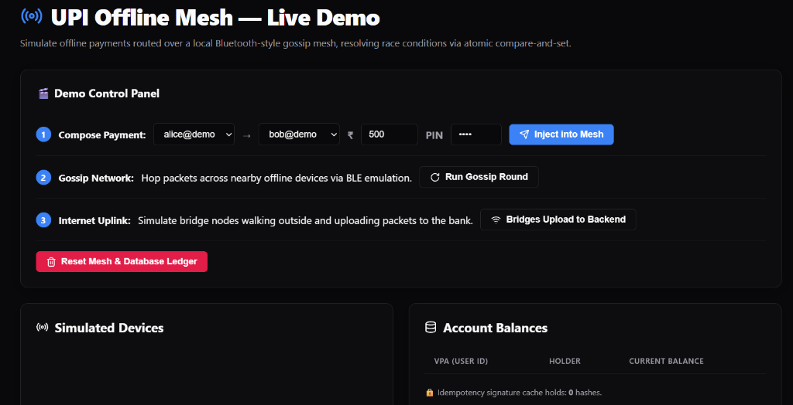
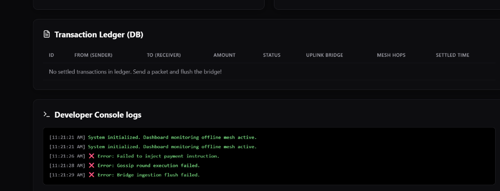

# MeshPay: Mesh-Based Offline Payment Simulator

A production-grade distributed system simulator demonstrating decentralized, deferred settlement of cryptographically secure offline payments over a Bluetooth-style gossip mesh network.

---

## 🔍 Overview

**MeshPay** is an engineering simulator built to demonstrate the viability of **deferred-settlement offline payments** in connectivity-starved environments (e.g., underground basements, remote rural zones, transit tunnels, or post-disaster networks). 

The simulator models a real-world scenario where a sender (Alice) wants to make a secure digital payment to a receiver (Bob) without either device having access to the internet. 

### The Core Concept:
1. **Local Encryption**: Alice's device packages a payment instruction containing transaction details, a unique nonce, and a time stamp. It encrypts this payload using a hybrid cryptography model (AES-256 GCM + RSA-OAEP).
2. **Gossip Diffusion**: The encrypted packet is broadcast to nearby devices using Bluetooth Low Energy (BLE) or Wi-Fi Direct protocols. The packet propagates device-to-device through a peer-to-peer mesh topology.
3. **Gateway Uplink**: When any device carrying the packet (a "bridge node") enters an area with cellular connectivity (4G/Wi-Fi), it uploads the queued packet to the central payment network backend.
4. **Backend Settlement**: The Spring Boot backend decrypts the payload, runs strict security and freshness verifications, executes an atomic idempotency check to prevent double-spending, and settles the transaction in the PostgreSQL database.

> [!NOTE]  
> This project is a **software simulator** built for educational and engineering demonstration purposes. It mocks real-world wireless hardware constraints using a visual, stateful state-machine mesh graph.

---

## 📸 Screenshots

### 🖥️ Interactive System Dashboard

*Figure 1: The main control center showing real-time network topology node connectivity, manual payment composition, bank account ledgers, and live telemetry indicators.*

### 🛠️ Simulation Control & Encryption Flow

*Figure 2: The interview demo scenarios manager, the live step-by-step hybrid cryptography pipeline visualization, active timeline stepper, and scrolling system logs.*

---

## 🎨 Features

*   **Offline Payment Simulation**: Mock the creation of encrypted payment packets on offline devices.
*   **Gossip Packet Routing**: Animate and track device-to-device packet transfers with configurable TTL (Time-To-Live) and link latencies.
*   **Virtual Devices Topology**: Inspect mock mobile hardware stats (battery status, latency, Bluetooth signal strength, and offline queues) via an interactive SVG network graph.
*   **Hybrid Encryption Visualizer**: Watch a real-time visualization of JSON payloads being encrypted using AES-GCM and wrapped inside an RSA-OAEP envelope.
*   **Active Progress Timeline**: Monitor transaction states along a 9-stage pipeline from local creation to final ledger settlement.
*   **PostgreSQL Bank Ledger**: View real-time updates to bank account balances as transactions settle.
*   **Idempotent Ingestion Gate**: Test duplicate-storm scenarios where multiple bridges upload the same packet concurrently; the backend settles it exactly once.
*   **Failure & Relay Control**: Take nodes offline manually to test local queuing on bridge devices, or corrupt ciphertext bytes to witness instant cryptographic drop-rejections.

---

## 🏗️ Architecture

```mermaid
flowchart TD
    subgraph Client Layer (Offline)
        A[React Dashboard Client] -->|1. Inject Payment| B(Alice Virtual Device)
        B -->|2. Gossip P2P Hoops| C[Relay Node Alpha / Beta]
        C -->|3. BLE Broadcast| D(Bridge Node)
    end
    
    subgraph Gateway Uplink (Online)
        D -->|4. Walk into 4G / Wi-Fi Coverage| E[Central Ingestion Service]
    end
    
    subgraph Central Payment Backend (Server)
        E -->|5. POST /api/bridge/ingest| F[REST API Controller]
        F -->|6. Decrypt & Verify| G[Hybrid Crypto Service]
        G -->|7. Deduplicate check| H[Idempotency Service]
        H -->|8. Atomic Balance Update| I[Settlement Engine]
        I -->|9. Persistence| J[(PostgreSQL Database)]
    end
    
    J -->|10. Sync Updated Balances| A
```

---

## 🔄 Payment Lifecycle

1.  **Creation**: Seder inputs VPA destinations, payment amount, and a secure PIN.
2.  **Encryption**: Client generates a one-time 256-bit AES symmetric key to encrypt the payload, then encrypts that AES key using the server's 2048-bit RSA public key.
3.  **Local Queueing**: The sealed base64 package is loaded into the sender's local memory stack.
4.  **Routing (Gossip)**: Packet replicates P2P across nodes. Each hop decrements the packet's TTL.
5.  **Uplink Ingestion**: A bridge node connects to the server and uploads the packet via a parallel stream.
6.  **Idempotency Check**: Server computes the SHA-256 hash of the ciphertext and runs an atomic check-and-set in the cache.
7.  **Decryption**: Server decrypts the AES key using its private RSA key, then decrypts the payload.
8.  **Settlement**: Version-locked JPA transactions deduct funds from the sender and credit the receiver.
9.  **Ledger Update**: Balances are permanently committed, and the React UI refreshes the ledger display.

---

## 📂 Project Structure

```
OflineDistributedPaymentSystem/
├── .mvn/                     # Maven wrapper configuration
├── docs/
│   └── assets/               # Screenshots and image files
├── frontend/
│   ├── src/
│   │   ├── App.jsx           # Main React Dashboard UI component
│   │   ├── index.css         # Styling rules and CSS Grid layouts
│   │   └── main.jsx          # React app entry point mounting script
│   ├── index.html            # Main HTML layout wrapper
│   ├── package.json          # Node.js dependencies descriptor
│   └── vite.config.js        # Vite config with API proxy targets
├── src/
│   ├── main/
│   │   ├── java/com/demo/upimesh/
│   │   │   ├── config/       # AppConfig configures CORS/Scheduling
│   │   │   ├── controller/   # ApiController hosts REST API endpoints
│   │   │   ├── crypto/       # ServerKeyHolder & HybridCryptoService
│   │   │   ├── model/        # Account, Transaction entities & Repositories
│   │   │   ├── service/      # Settlement, Gossip, & Idempotency Services
│   │   │   └── UpiMeshApplication.java  # Spring Boot launcher class
│   │   └── resources/
│   │       ├── templates/    # dashboard.html backup views
│   │       └── application.properties   # Database/App config parameters
│   └── test/                 # Concurrency unit test suites
├── docker-compose.yml        # PostgreSQL service container descriptor
├── mvnw & mvnw.cmd           # Maven Unix & Windows launcher scripts
├── pom.xml                   # Maven project dependencies descriptor
└── README.md                 # Project documentation
```

---

## 💻 Technology Stack

*   **Backend**: Spring Boot 3.3.5 (Java 17)
*   **Database**: PostgreSQL 15 (JPA / Hibernate ORM)
*   **Frontend**: React 19, Vite, Lucide Icons, Web Audio API
*   **Build Systems**: Maven (Backend Wrapper), npm (Frontend Node)
*   **Security**: Java Cryptography Architecture (JCE), AES-256-GCM, RSA-2048 with OAEP-Padding

---

## ⚙️ Key Components

*   **Mesh Simulator**: A stateful service running P2P packet exchange loops, modeling wireless relays, decrementing packet TTLs, and managing local queues.
*   **Idempotency Service**: Prevents double-spending by hashing incoming packets and running thread-safe `putIfAbsent` checks in a TTL-bounded cache.
*   **Hybrid Crypto Module**: Performs high-performance envelope decryption, checking data integrity via GCM authenticated tags and encrypting session keys via RSA-OAEP.
*   **Settlement Engine**: Transactional service utilizing database-level locking and JPA versioning to ensure thread-safe balance deductions and credits.

---

## 🕹️ Demo Scenarios

The simulator provides 6 interactive presets to test and showcase distributed payment mechanics:

1.  **Successful Flow**: Alice sends a payment. The packet travels: `Alice ➔ Relays ➔ Bridge`. The bridge node uploads it, the server decrypts it, and the bank accounts reflect the settled balances.
2.  **Offline Queue**: Takes the bridge offline. Alice sends a payment; the packet travels to the bridge and queues up in its memory. When the bridge goes back online, the queue flushes and settles.
3.  **Duplicate Payment**: Alice's payment propagates to two different relay nodes. Both upload the packet to the server in parallel. The server processes the first and drops the second as a duplicate transaction, preventing double-debits.
4.  **Packet Relay**: Traces multi-hop BLE transmissions across the intermediate relays, validating path routing.
5.  **Batch Settlement**: Alice and Carol compose payments while offline. The mesh collects them, and the gateway settles both in a single concurrent upload batch.
6.  **Corrupt Packet**: Simulates a man-in-the-middle attack by corrupting a byte in the packet's ciphertext. The server detects the alteration during decryption (GCM tag mismatch) and rejects the packet.

---

## 🔌 API Endpoints

| Method | Endpoint | Purpose |
| :--- | :--- | :--- |
| **GET** | `/api/accounts` | Fetch list of account VPAs and balances |
| **GET** | `/api/transactions` | Fetch latest 20 settled transaction ledger entries |
| **GET** | `/api/mesh/state` | Fetch the active packet queue sizes and node statuses |
| **GET** | `/api/server-key` | Fetch the server's active RSA public key |
| **POST** | `/api/demo/send` | Encrypt a payment instruction and inject it at `phone-alice` |
| **POST** | `/api/mesh/gossip` | Execute a mesh network gossip round |
| **POST** | `/api/mesh/flush` | Collect queued packets from online bridges and upload them |
| **POST** | `/api/mesh/reset` | Clear database ledgers, caches, and reset account balances |
| **POST** | `/api/bridge/ingest` | Raw endpoint for direct bridge ingestion |

---

## 💾 Database Design

```
+--------------------+              +--------------------+
|      accounts      |              |    transactions    |
+--------------------+              +--------------------+
| PK | vpa (VARCHAR) |              | PK | id (BIGINT)   |
|    | holder_name   |              | UK | packet_hash   |
|    | balance (NUM) |              |    | sender_vpa    |
|    | version (LONG)|              |    | receiver_vpa  |
+--------------------+              |    | amount (NUM)  |
                                    |    | signed_at     |
                                    |    | settled_at    |
                                    |    | bridge_node_id|
                                    |    | hop_count     |
                                    |    | status (ENUM) |
                                    +--------------------+
```
*   **Concurrency Control**: The `accounts` table uses a `@Version` field to prevent write collisions during parallel settlements.
*   **Deduplication**: The `transactions` table enforces a unique index on `packet_hash` to reject duplicate inserts at the database level.

---

## 🔧 Installation & Setup

### 1. Prerequisites
Ensure the following are installed:
*   [Java JDK 17](https://adoptium.net/temurin/releases/?version=17) (verify with `java -version`)
*   [Node.js](https://nodejs.org/) (LTS version)
*   [PostgreSQL](https://www.postgresql.org/) (running locally on port `5432` with database `upimesh`)

### 2. Database Configuration
By default, the backend expects a PostgreSQL database with these parameters:
*   **Database**: `upimesh`
*   **User**: `postgres`
*   **Password**: `1824`
*(If you need to change these, edit `src/main/resources/application.properties` before running).*

### 3. Running the Backend
1. Open a terminal in the project root folder.
2. Build and run the Spring Boot server:
   ```cmd
   # Windows
   mvnw.cmd spring-boot:run
   
   # Linux/Mac
   chmod +x mvnw
   ./mvnw spring-boot:run
   ```
3. The server starts on **`http://localhost:8080`**.

### 4. Running the Frontend
1. Open a second terminal tab and navigate to the frontend folder:
   ```bash
   cd frontend
   ```
2. Install dependencies and start the Vite dev server:
   ```bash
   npm install
   npm run dev
   ```
3. Open your browser and navigate to the URL shown (typically **`http://localhost:5174`** or `5173`).

---

## 🚀 Future Enhancements

*   **Distributed Cache**: Integrate Redis to manage the idempotency check layer.
*   **Message Broker**: Integrate Apache Kafka to process uploaded batches asynchronously.
*   **Containerization**: Add Dockerfiles and Kubernetes deployment manifests for scalable orchestration.
*   **Real-time Push**: Replace HTTP polling with WebSockets for instant dashboard topology syncs.
*   **Hardware Prototypes**: Extend P2P interfaces to interact with ESP32 BLE hardware modules.

---

## 📝 Resume Highlights

*   **Mesh Network Simulation**: Designed a stateful P2P simulation representing BLE gossip packet propagation across offline nodes.
*   **Hybrid Cryptography implementation**: Built a hybrid encryption pipeline combining fast symmetric encryption (AES-256 GCM) with secure key encapsulation (RSA-OAEP-2048) to secure transaction packets over untrusted networks.
*   **Idempotency & Concurrency Design**: Implemented double-spend protection utilizing an in-memory TTL-bounded cache and optimistic database locking to resolve parallel ingestion requests.
*   **Full-Stack Visual Dashboard**: Developed a high-end React dashboard with custom SVG canvas rendering, live transaction timelines, and Web Audio API synthesizer chimes to demonstrate distributed transaction flows.

---

## 🎓 Learning Outcomes

*   **REST API Design**: Structuring endpoints to trigger and query simulator state updates.
*   **Database Lock Operations**: Utilizing Spring Data JPA transaction bounds and entity versioning to handle database writes.
*   **Cryptography Practices**: Implementing authenticated key-exchange pipelines and GCM tag verifications.
*   **Responsive Client Design**: Managing complex states, delays, animations, and custom scrollbar elements in React.
